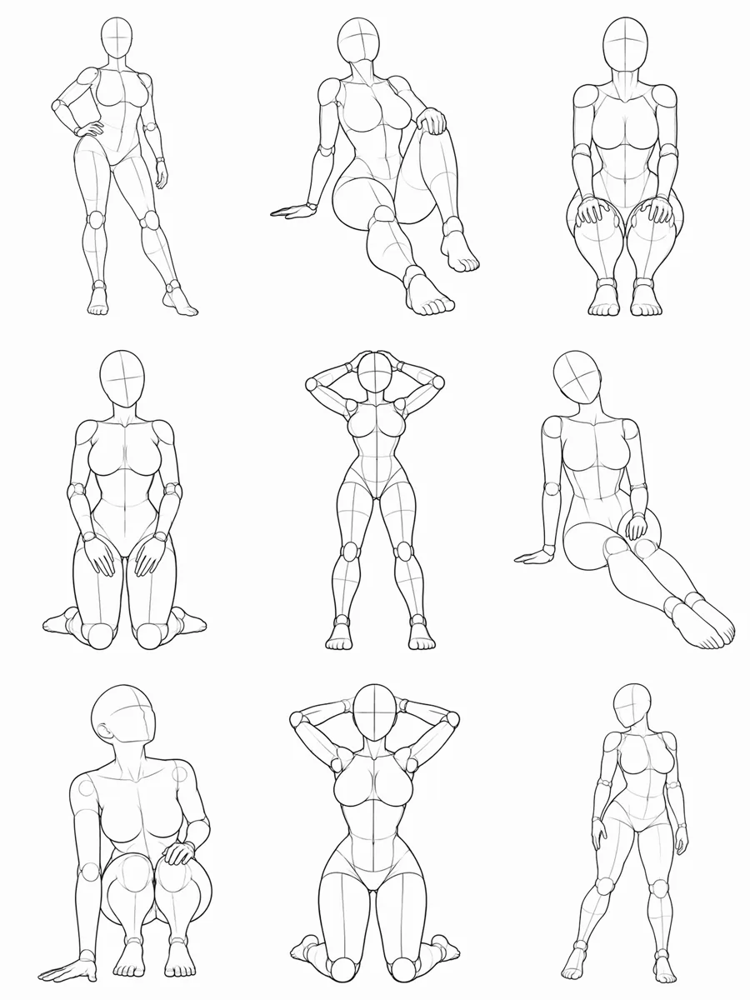

# Pose Reference

基于姿势参考图的 Agent Skills：查找姿势、根据参考图或文字生图，以及把同一个人物转成多动作九宫格。

## 示例：一张人物照生成九宫格

使用一张人物参考照和 9 个动作参考，先把动作参考拼成一张图，再交给图片生成工具**一次生成**九宫格。每一格对应一个动作，人物、服装和场景尽量保持一致。

| 人物参考 | 动作参考 | 生成结果 |
| --- | --- | --- |
|  |  |  |

示例人物及结果由 AI 生成。生成工具对人物和动作的还原程度可能不同。

## Skills

- **[pose-reference](SKILL.md)**：从本地姿势图库中查找动作和视角。
- **[pose-generator](pose-generator/SKILL.md)**：根据参考图、文字描述或两者结合生成一张图片。
- **[pose-transfer](pose-transfer/SKILL.md)**：使用一张人物照和 1～9 个动作，生成一张多姿势图片；未指定数量时默认 5 个。

## 使用示例

将人物图片交给支持这些 Skills 的 Agent，然后输入：

> 使用 pose-transfer，根据这张照片生成 9 个不同动作的九宫格，保持人物和服装一致。

Skill 会从图库选取动作，制作动作参考拼图，再调用可用的图片生成工具。图片生成需要 Agent 环境提供对应工具；动作选择和参考图拼接脚本需要 Python 3，拼图还需要 FFmpeg。

也可以在仓库根目录运行：

```bash
python3 pose-transfer/scripts/select_poses.py --count 9 --framing full
python3 pose-transfer/scripts/build_pose_sheet.py --count 9 --framing full --output pose-sheet.png
```

脚本输出动作 ID、顺序和本地路径，方便将拼图与人物照片一起用于生图。`pose-transfer` 的脚本依赖本仓库中的 `references/`、`assets/` 和 `scripts/`；单独复制该 Skill 目录不会带上图库。

## 图片来源

图库中的原始图片及数据属于原作者 ギア，来源和使用说明见 [references/source.md](references/source.md)。本仓库不声称拥有这些素材的商业使用授权。
