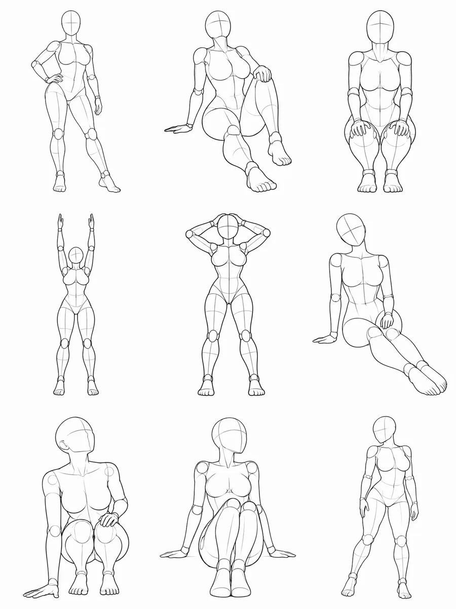
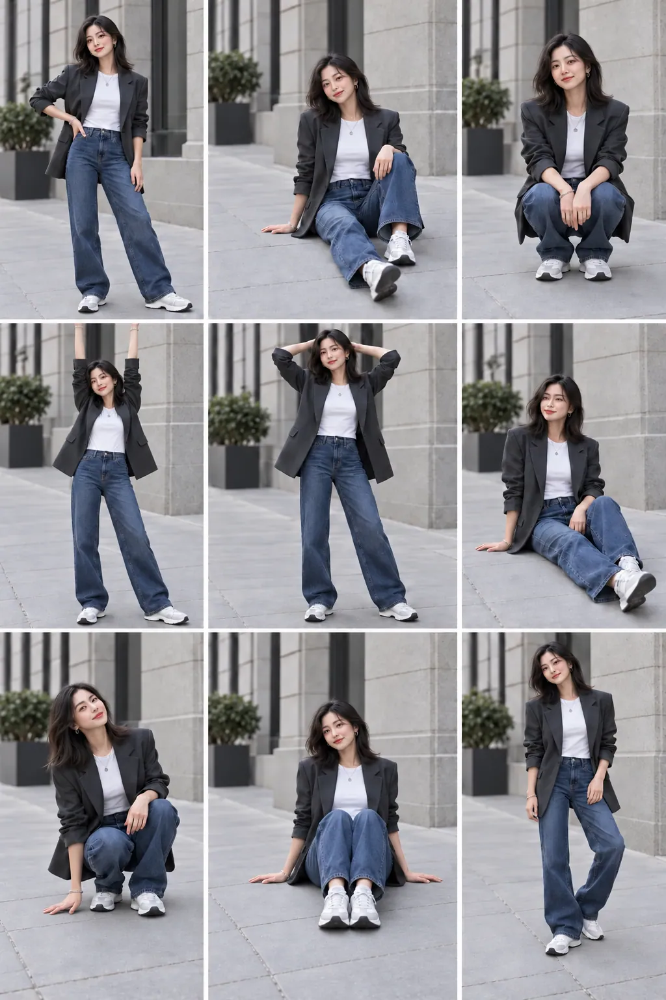
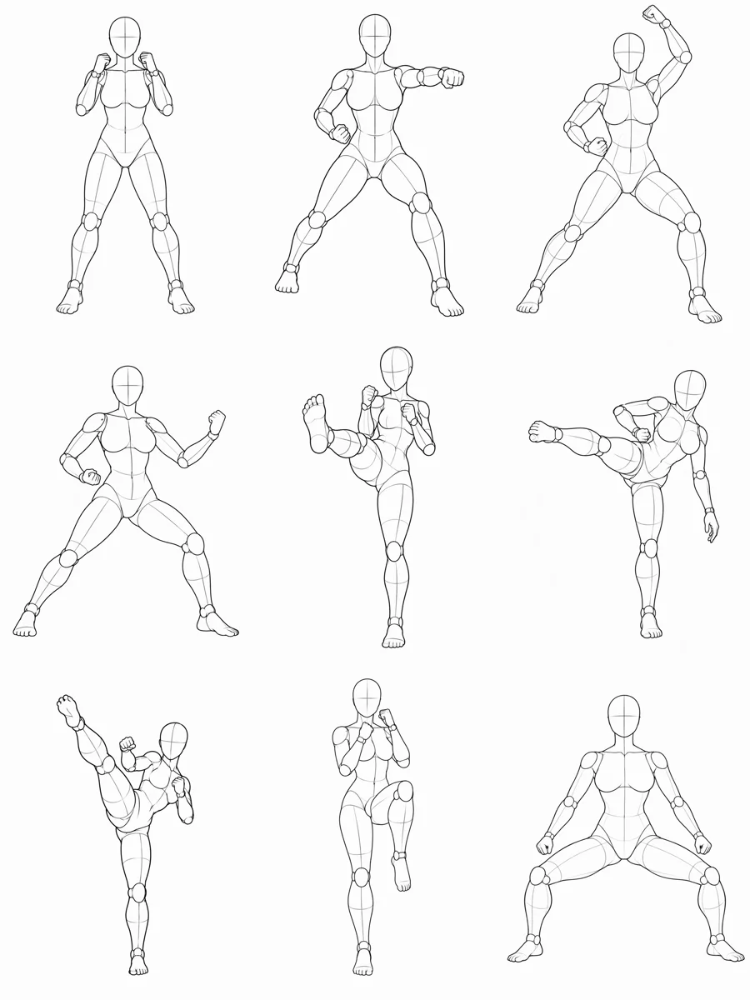
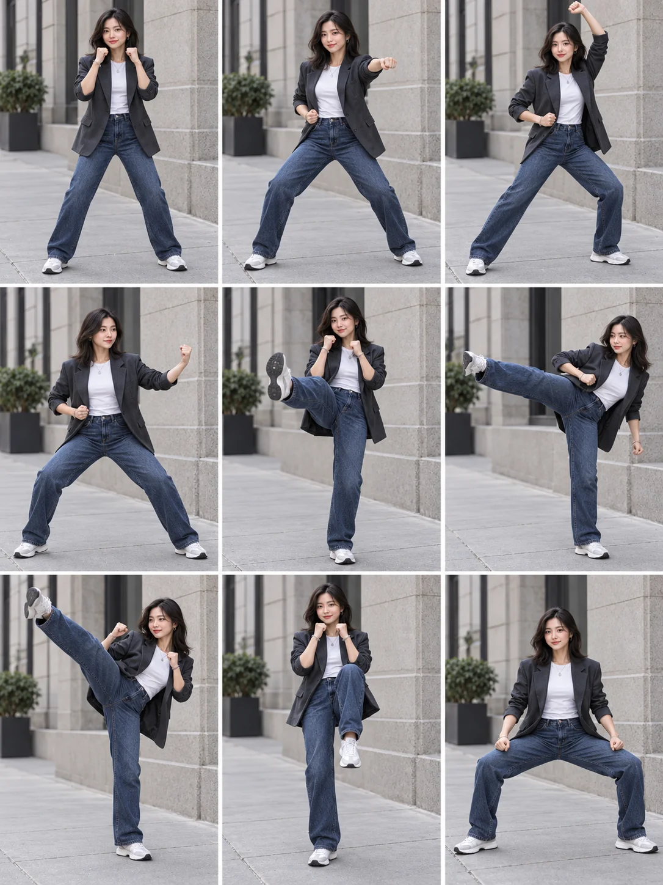

# Pose Skills

一个共享动作图库的 Agent Skills 项目：搜索姿势与动作参考、根据描述或参考生图、将同一人物转成多姿势图片，以及编写动作讲解与练习序列。各能力独立定义在 `skills/`，数据、来源和工具由整个仓库共享。

## 能力与现有数据

| Skill | 用途 |
| --- | --- |
| [pose-search](skills/pose-search/SKILL.md) | 按关键词、类别、标签、人数、景别和视角找参考 |
| [pose-generator](skills/pose-generator/SKILL.md) | 根据文字或参考生成一张图片 |
| [pose-transfer](skills/pose-transfer/SKILL.md) | 用人物图及 1～9 个参考生成一张多动作图片 |
| [form-coach](skills/form-coach/SKILL.md) | 解释动作或根据可观察的材料讨论动作形式 |
| [routine-builder](skills/routine-builder/SKILL.md) | 根据目标、条件和经验编排练习序列 |

[根目录 SKILL.md](SKILL.md) 是分流入口。要保留完整仓库目录才能共享数据和脚本；单独复制一个子 Skill 不包含其依赖。是否自动发现嵌套 Skill 取决于 Agent 环境，可直接指定对应的 `SKILL.md` 或从根入口路由。

- `categories/reference`：现有ギア姿势图库，包括静态线稿及多个视角；部分内容为成人向，默认不显示。
- `categories/kungfu`：独立的功夫动作分类，含 AI 生成的空手道和跆拳道姿势参考；原参考图来源及授权信息见分类内的 `source.md`。
- `categories/fitness`、`categories/sports`、`categories/yoga`：已建立数据结构，**目前没有动作素材或教学数据**。不能将通用参考图库当作训练动作标准。
- 教学和训练建议需要合适的可靠来源；图片生成需要 Agent 环境提供支持参考图的生成工具。

## 安装与依赖

完整流程需要：

- **Git**：获取项目。
- **Python 3.9 或更高版本**：运行动作搜索和拼图脚本，无需额外安装 Python 包。
- **FFmpeg 和 ffprobe**：生成动作参考拼图；两个命令通常由同一个 FFmpeg 软件包提供。
- **支持参考图的图像生成工具**：由所用 Agent 环境提供，并能接收人物图和动作参考图。项目脚本负责搜索和整理参考图，最终图片由图像生成工具生成。
- **cwebp**：仅在将新增图片压缩到项目时需要，普通搜索和生成不需要。

例如，在 macOS 上使用 Homebrew 安装依赖：

```bash
brew install git python ffmpeg webp
```

在 Debian / Ubuntu 上可使用：

```bash
sudo apt update
sudo apt install git python3 ffmpeg webp
```

克隆完整仓库，并将根 Skill 链接到常见的 Agent Skills 目录：

```bash
git clone https://github.com/jyjyxt/pose-reference.git
cd pose-reference
mkdir -p ~/.agents/skills
ln -s "$(pwd)" ~/.agents/skills/pose-skills
```

保留克隆目录，链接依赖其中的 `skills/`、`shared/` 和 `categories/`；若目标链接已存在，先确认其指向，避免覆盖。不同 Agent 的技能目录和发现方式可能不同；如未自动发现，可在对话中要求 Agent 读取本仓库的 `SKILL.md` 或 `skills/pose-transfer/SKILL.md`。安装后按 Agent 的要求重新加载技能或重启会话。

## 从人物图生成九宫格

1. **准备人物参考图。** 提供一张人物照片或其本地路径。图像生成工具需要能读取此图和项目动作图；也可以用仓库内的 `examples/reference/fashion-portrait.webp` 体验。
2. **选择动作。** 查看 [功夫动作编号](categories/kungfu/numbered-poses.md)，或者让 Agent 自动选九个。也可在仓库根目录搜索编号：

   ```bash
   python3 shared/scripts/search.py --category kungfu --query KF001
   ```

3. **告诉 Agent 生成要求。** 在支持图像生成的 Agent 中，提供人物图并发送，例如：

   > 使用 pose-transfer，把 `examples/reference/fashion-portrait.webp` 中的人物生成一张功夫九宫格，依次使用 KF012、KF001、KF004、KF005、KF009、KF011、KF010、KF023、KF026；保持人物、服装和场景一致。

   Agent 应读取 `pose-transfer` 技能，按编号找到动作参考，结合人物图一次生成一张 3×3 图片。未指定动作时可让 Agent 选择；未指定数量时该技能默认生成五个动作，最多九个。要求九宫格时应明确写九个。

4. **查看并保存结果。** 确认九个格子和所选动作相符，并按所用图像工具的方式保存生成图片。不同视角和动作是模型生成的近似结果，人物一致性和动作准确性不保证完全相同。

如果想手动准备同一组动作参考拼图，在仓库根目录运行以下命令；输出路径必须是不存在的新文件：

```bash
python3 skills/pose-transfer/scripts/build_pose_sheet.py \
  --output /tmp/kungfu-nine-reference.png \
  --id kungfu:guard-stance --id kungfu:oi-zuki --id kungfu:age-uke \
  --id kungfu:soto-uke --id kungfu:mae-geri --id kungfu:yoko-geri \
  --id kungfu:mawashi-geri --id kungfu:knee-strike --id kungfu:wide-stance
```

脚本输出拼图路径及格子与动作 ID 的对应关系。`--id` 接受动作 ID 或视角 ID，按传入顺序排列；编号和动作 ID 的对应关系见编号表。将这张拼图与人物图交给支持参考图的图像生成工具，才能生成最终人物图片。

## 示例：一张人物照生成九宫格

| 人物参考 | 动作参考 | 生成结果 |
| --- | --- | --- |
|  |  |  |

示例人物及结果由 AI 生成。单次生成可改善一致性，但不保证人物和动作完全一致。

### 功夫动作九宫格

| 人物参考 | 动作参考 | 生成结果 |
| --- | --- | --- |
|  |  |  |

动作按从左到右、从上到下排列：KF012 防守架势、KF001 追步直拳、KF004 上段格挡、KF005 外格挡、KF009 前踢、KF011 侧踢、KF010 回旋踢、KF023 提膝击、KF026 宽马步。示例人物和结果由 AI 生成，动作图用于姿势参考，不作为动作教学标准。

## 命令

在仓库根目录运行（或使用脚本绝对路径）；需要 Python 3.9+。拼图需 FFmpeg，图片压缩需 `cwebp`、`ffprobe` 和 FFmpeg：

```bash
python3 shared/scripts/search.py --query 站姿 --people 1 --framing full_body --angle front --distinct
python3 skills/pose-transfer/scripts/select_poses.py --count 9 --framing full
python3 skills/pose-transfer/scripts/build_pose_sheet.py --count 9 --framing full --output /tmp/pose-sheet.png
python3 shared/scripts/validate.py --check-index
```

搜索结果中的 `id` 是动作 ID，`view_id` 是具体视角 ID；重复传入 `--id` 可指定选择顺序。动态动作会返回阶段。按类别或领域筛选可用 `--category`、`--domain` 和重复的 `--tag`；动态阶段和道具可用 `--phase`、`--prop`；各脚本的 `--help` 有完整参数。默认只返回 `general` 内容，明确要求成人素材时可传 `--adult`；`unknown` 数据需先审核分类。

## 扩展数据

1. 复制 `templates/category/` 到 `categories/<类别名>/`，补充 `CATEGORY.md`、`source.md` 和 `sources.json`。每项来源记录需有 `description` 和 `url`；动作或视角通过 `source_id` 关联，可由视角覆盖动作来源。
2. 将图片放到类别的 `img/`，按 [taxonomy.md](shared/taxonomy.md) 和 [pose.schema.json](shared/pose.schema.json) 编写 `poses.json`。静态姿势使用 `views`，动态动作使用按顺序排列的 `phases`，阶段下的视角提供具体图像。
3. 新图先压缩并检查可读性：`python3 shared/scripts/compress_images.py <图片路径> --output-dir <目标目录>`。脚本输出 WebP、不缩放、不覆盖，并验证尺寸及可解码性；人工检查文字、细节是否仍清晰。
4. 执行 `python3 shared/scripts/validate.py`，再执行 `python3 shared/scripts/build_index.py`。提交前运行 `python3 shared/scripts/validate.py --check-index`；索引是生成产物，不手改。搜索和选择会拒绝过期索引。
5. 检查对应检索、视角和参考拼图。未经验证或没有适用授权的素材与教学数据不应入库。

类别文件是数据真源，分类目录作为维护边界，`domains` 和标签支持跨类别检索。来源记录用于追溯，不能替代核实实际授权。

## 素材来源

现有参考图库及原始数据属于 ギア；中文数据来源及具体使用限制见 [source.md](categories/reference/source.md)。本仓库不声称拥有这些素材的商业使用授权。
